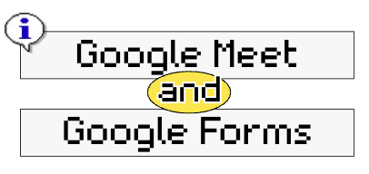
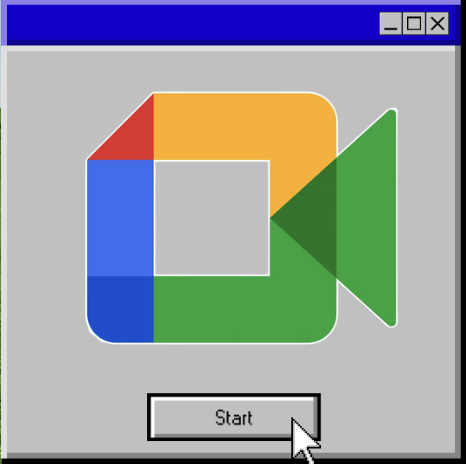
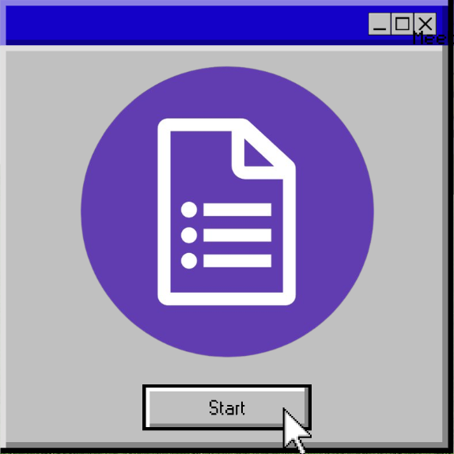
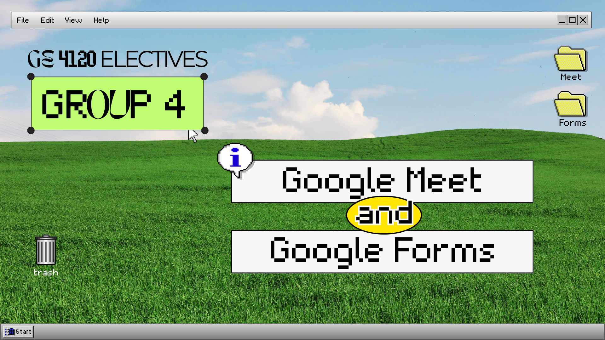

 

<b> ⟡⋆˙ ᴍɪᴅᴛᴇʀᴍ ʀᴇᴘᴏʀᴛɪɴɢ ⋆˙⟡ </b>

<i> 
 ɢᴏᴏɢʟᴇ ᴍᴇᴇᴛ ᴀɴᴅ ɢᴏᴏɢʟᴇ ꜰᴏʀᴍꜱ
</i>

 

  

 

This activity explores the purpose, features, and practical applications of <b>Google Meet and Google Forms</b> as essential digital tools for communication, collaboration, and information management.

<table>
<tr>
<td width="14%" align="center">

</td>

<td width="70%">

<b>Google Meet</b> is an online video conferencing platform that enables users to conduct virtual meetings, online classes, presentations, and group discussions through features such as screen sharing, in-meeting chat, captions, and collaborative controls.

</td>
</tr>
</table>

<table>
<tr>
<td width="14%" align="center">

</td>

<td width="70%">

Meanwhile, <b>Google Forms</b> allows users to create surveys, quizzes, registration forms, and feedback forms, collect responses in real time, and organize data through automatic summaries and Google Sheets integration.

</td>
</tr>
</table>
  
<i>

Through this activity, we learned how to navigate both platforms, understand their essential functions, and apply their features through practical demonstrations and interactive quizzes. These tools demonstrate how technology can make communication more accessible, simplify information gathering, support learning assessment, and improve productivity in academic and professional settings.

</i>

<a href="Activity%204%20Outputs/GROUP-4-FORMS%20AND%20MEET%20PPT.pdf">
  📄 View Google Meet & Forms PPT →
</a>

 
 

<a href="https://docs.google.com/forms/d/e/1FAIpQLSfperDHgiW2recV86enfxMl6Lav0aZCxHtS3fycjsJGuVEPvw/viewform?usp=sharing&ouid=118413879498339873868">
  📝 View Google Forms Quiz →
</a>

 
 

<a href="Activity%204%20Outputs/GE-4120_G4_Quiz.pdf">
  📊 View Quiz Scores →
</a>

 
 

 

 
 

<i>

𝚃𝚑𝚛𝚘𝚞𝚐𝚑 𝚝𝚑𝚒𝚜 𝚊𝚌𝚝𝚒𝚟𝚒𝚝𝚢, 𝙸 𝚕𝚎𝚊𝚛𝚗𝚎𝚍 𝚑𝚘𝚠 𝙶𝚘𝚘𝚐𝚕𝚎 𝙼𝚎𝚎𝚝 𝚊𝚗𝚍 𝙶𝚘𝚘𝚐𝚕𝚎 𝙵𝚘𝚛𝚖𝚜 𝚌𝚊𝚗 𝚖𝚊𝚔𝚎 𝚌𝚘𝚖𝚖𝚞𝚗𝚒𝚌𝚊𝚝𝚒𝚘𝚗, 𝚌𝚘𝚕𝚕𝚊𝚋𝚘𝚛𝚊𝚝𝚒𝚘𝚗, 𝚊𝚗𝚍 𝚒𝚗𝚏𝚘𝚛𝚖𝚊𝚝𝚒𝚘𝚗 𝚐𝚊𝚝𝚑𝚎𝚛𝚒𝚗𝚐 𝚖𝚘𝚛𝚎 𝚎𝚏𝚏𝚒𝚌𝚒𝚎𝚗𝚝. 𝙶𝚘𝚘𝚐𝚕𝚎 𝙼𝚎𝚎𝚝 𝚑𝚎𝚕𝚙𝚜 𝚙𝚎𝚘𝚙𝚕𝚎 𝚌𝚘𝚗𝚗𝚎𝚌𝚝 𝚟𝚒𝚛𝚝𝚞𝚊𝚕𝚕𝚢, 𝚠𝚑𝚒𝚕𝚎 𝙶𝚘𝚘𝚐𝚕𝚎 𝙵𝚘𝚛𝚖𝚜 𝚖𝚊𝚔𝚎𝚜 𝚒𝚝 𝚎𝚊𝚜𝚒𝚎𝚛 𝚝𝚘 𝚌𝚛𝚎𝚊𝚝𝚎 𝚚𝚞𝚒𝚣𝚣𝚎𝚜, 𝚌𝚘𝚕𝚕𝚎𝚌𝚝 𝚏𝚎𝚎𝚍𝚋𝚊𝚌𝚔, 𝚊𝚗𝚍 𝚘𝚛𝚐𝚊𝚗𝚒𝚣𝚎 𝚛𝚎𝚜𝚙𝚘𝚗𝚜𝚎𝚜. 

𝚃𝚑𝚒𝚜 𝚊𝚌𝚝𝚒𝚟𝚒𝚝𝚢 𝚑𝚎𝚕𝚙𝚎𝚍 𝚖𝚎 𝚊𝚙𝚙𝚛𝚎𝚌𝚒𝚊𝚝𝚎 𝚑𝚘𝚠 𝚍𝚒𝚐𝚒𝚝𝚊𝚕 𝚝𝚘𝚘𝚕𝚜 𝚌𝚊𝚗 𝚜𝚞𝚙𝚙𝚘𝚛𝚝 𝚖𝚢 𝚕𝚎𝚊𝚛𝚗𝚒𝚗𝚐, 𝚝𝚎𝚊𝚖𝚠𝚘𝚛𝚔, 𝚊𝚗𝚍 𝚏𝚞𝚝𝚞𝚛𝚎 𝚗𝚞𝚛𝚜𝚒𝚗𝚐 𝚙𝚛𝚊𝚌𝚝𝚒𝚌𝚎.

</i>

 

