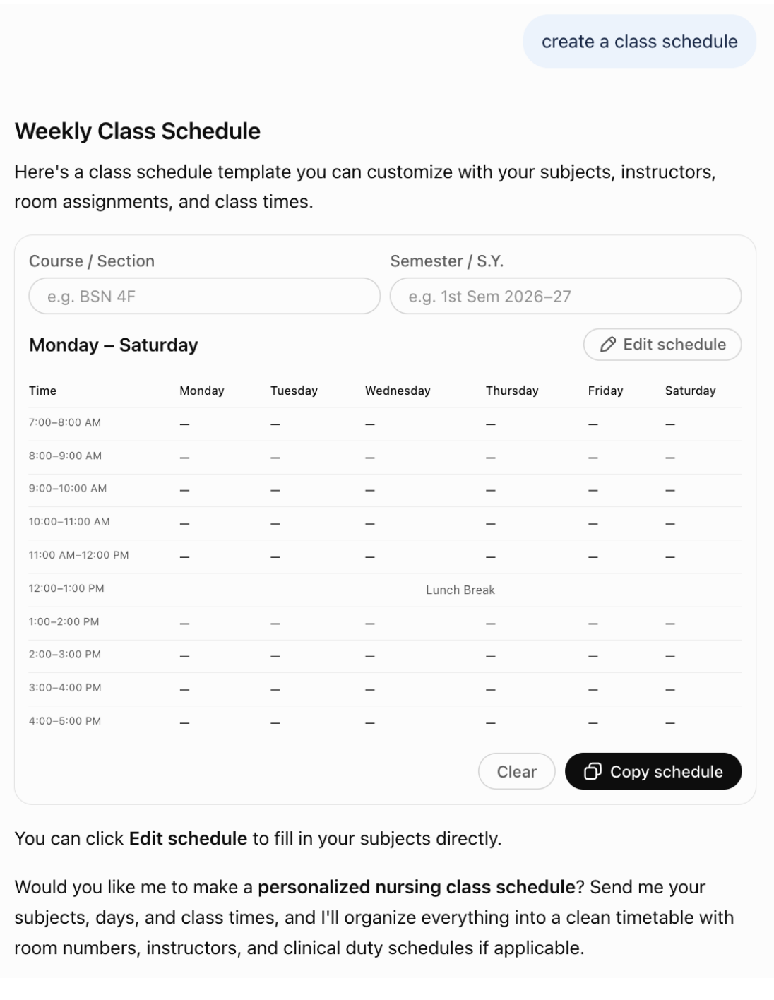
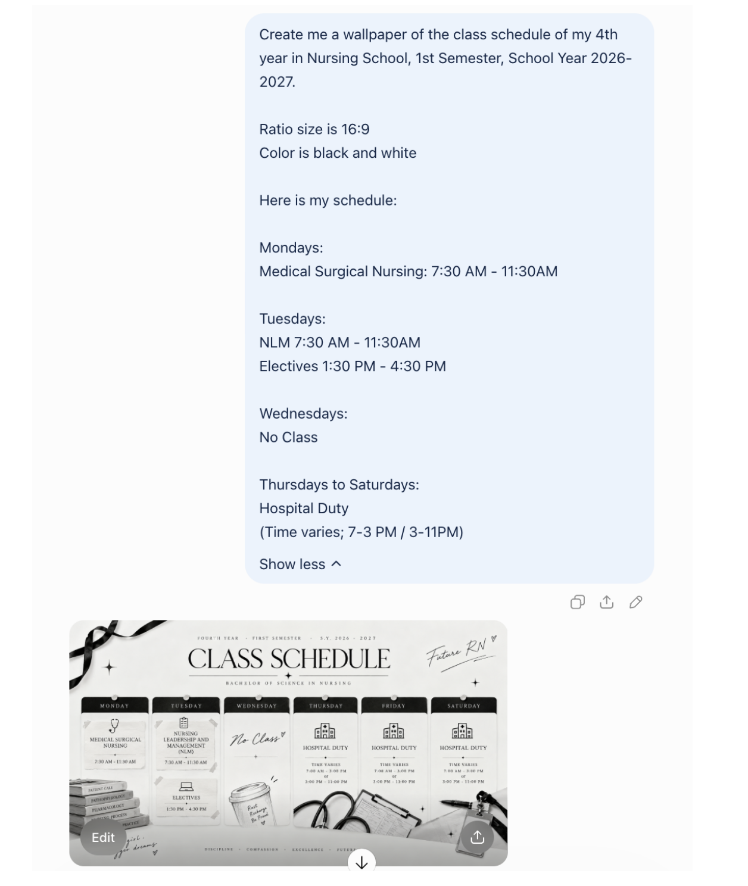

 

<b> ⟡⋆˙ ᴀɪ ᴛᴏᴏʟꜱ ᴀᴄᴛɪᴠɪᴛʏ ⋆˙⟡ </b>

<i> 
 ᴇxᴘʟᴏʀɪɴɢ ᴀʀᴛɪꜰɪᴄɪᴀʟ ɪɴᴛᴇʟʟɪɢᴇɴᴄᴇ ᴛʜʀᴏᴜɢʜ ᴄʜᴀᴛɢᴘᴛ
</i>

 

  
 

This activity explores the use of <b>ChatGPT</b> as an <b>artificial intelligence tool</b> for generating and improving creative outputs. Using a weekly nursing class schedule as the main task, I experimented with how AI can transform a simple instruction into a more personalized and visually appealing design.

The activity involved creating an initial schedule using an original prompt and then refining the instructions to include specific subjects, class hours, a preferred black-and-white color scheme, and nursing-related illustrations.

  
 

The initial instruction was simply to create a class schedule. This generated a basic weekly timetable template that could be customized with subjects, instructors, room assignments, and class times.

  
 

  
 

The prompt was improved by providing my actual fourth-year nursing schedule, specifying the 16:9 aspect ratio, requesting a black-and-white theme, and incorporating nursing-related visual elements. This allowed ChatGPT to generate a more personalized class schedule wallpaper that reflected my academic routine.

  
 

The <b>first output</b> is a weekly class schedule in table format, while the <b>second output</b> is a
customized black-and-white wallpaper designed specifically for a fourth-year nursing student. In
terms of clarity, the first output provides a simple and organized timetable that makes it easy to
identify subjects, days, and class hours. However, it is only a general template and does not
initially contain the actual nursing schedule. In comparison, the second output presents the
provided schedule in a more visually appealing and detailed layout, incorporating
nursing-related illustrations such as a stethoscope, hospital buildings, medical books, and
clinical materials. Regarding accuracy, the second output closely follows the given information,
including the subjects and hospital duty schedules, although it uses 7:00 AM–3:00 PM for duty,
which matches the intended shift. Overall, the first output focuses on simplicity and organization,
while the second emphasizes personalization, creativity, and visual presentation

In terms of usefulness, both outputs serve different purposes depending on the user's
needs. The first output is more practical for students who frequently change their schedules
because it allows them to edit subjects and class times easily. It is also useful for organizing
additional information, such as room assignments and instructors. On the other hand, the
second output is more suitable for everyday use as a desktop or laptop wallpaper because it
provides an attractive and convenient way to view the weekly schedule without opening another
document. Its black-and-white theme creates a clean and professional appearance, while the
nursing-related designs make it more meaningful and motivating. However, the wallpaper is less
flexible when schedule changes are needed. Overall, the second output is more effective for the
specific request because it successfully combines the actual class schedule with the preferred
design, format, and theme, making it both functional and aesthetically pleasing.

 

 
 

<i>

Through this activity, I learned that artificial intelligence can be a useful tool for improving productivity and creativity. I realized that the quality of an AI-generated output depends greatly on how clearly and specifically instructions are provided. By refining my original prompt, I was able to achieve a result that better matched my needs and preferences. This experience also taught me the importance of reviewing AI-generated content for accuracy rather than relying on it entirely. Overall, I learned that ChatGPT can serve as a helpful creative and learning assistant when used thoughtfully and responsibly.

</i>

 

