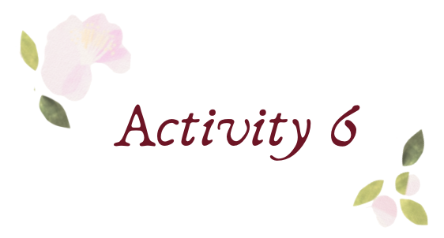
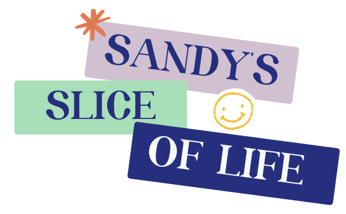
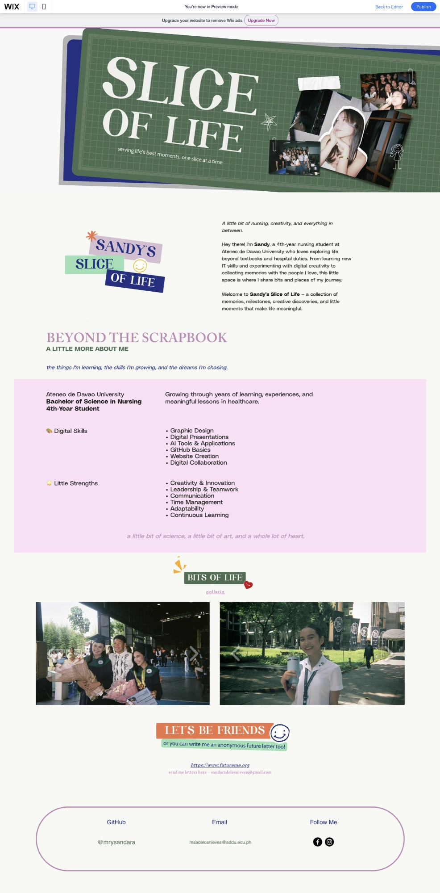

 

<b> ⟡⋆˙ ᴍᴀᴋɪɴɢ ᴀ ᴡᴇʙꜱɪᴛᴇ ⋆˙⟡ </b>

<i> 
ᴄʀᴇᴀᴛɪɴɢ ᴍʏ ᴘᴇʀꜱᴏɴᴀʟ ᴘᴏʀᴛꜰᴏʟɪᴏ ᴜꜱɪɴɢ ᴡɪx
</i>

 

  
 

This activity focuses on creating a creative and interactive one-page personal portfolio website using Wix, with the assistance of <b>AI-powered website design tools</b>. The website, entitled "Sandy's Slice of Life," serves as a digital introduction that showcases my identity as a fourth-year nursing student, including my educational background, digital skills, interests, personal experiences, and journey in learning Information Technology.

The website combines personalized content, photographs, creative layouts, and scrapbook-inspired visual elements to create an online space that reflects my personality, interests, and personal growth.

 

The website is organized into several sections:

🍰 <b>Slice of Life</b> – Introduces the website and provides a glimpse of my personal identity.

📓 <b>Beyond the Scrapbook</b> – Presents my educational background, digital skills, and personal strengths.

🌟 <b>Best of Life</b> – Features selected photographs and memorable personal experiences.

🫂 <b>Let's Be Friends</b> – Provides contact information and social media connections.

The website follows a scrapbook-inspired aesthetic, combining creative typography, personalized photographs, colorful visual elements, and organized content sections. Rather than using a traditional professional portfolio layout, I chose a more personal and expressive design that makes the website feel like a digital collection of memories and experiences.

  

I used <b>Wix AI</b> to help establish the initial website concept and layout. I then explored the editing tools to customize the sections, arrange the content, select photographs, adjust typography, and incorporate visual elements that matched my preferred aesthetic.

 
 

<i>
  

Creating my personal website using Wix was an enjoyable and meaningful learning experience. Initially, I was unfamiliar with website development, but with the help of AI-powered tools and Wix's editing features, I learned how to explore different layouts, customize designs, and organize information according to my preferences. I particularly enjoyed selecting the colors, typography, photographs, and scrapbook-inspired elements that made the website more personal and expressive.

</i>

<i>
  

As a nursing student, this activity also reminded me that learning skills beyond my chosen profession is valuable. Technology continues to influence healthcare, education, and communication, making digital literacy an important skill for future professionals. Overall, creating "Sandy's Slice of Life" helped me gain confidence in using digital tools, express my creativity, and discover new ways to share my experiences and personal growth.

</i>

 

