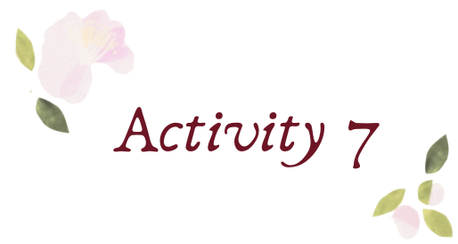
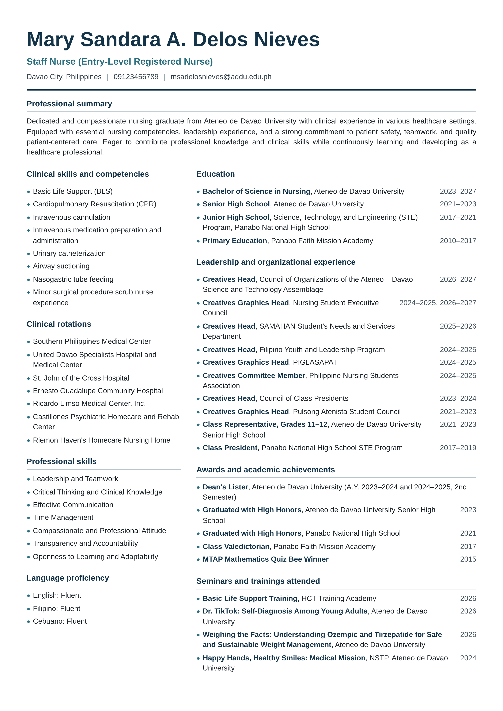
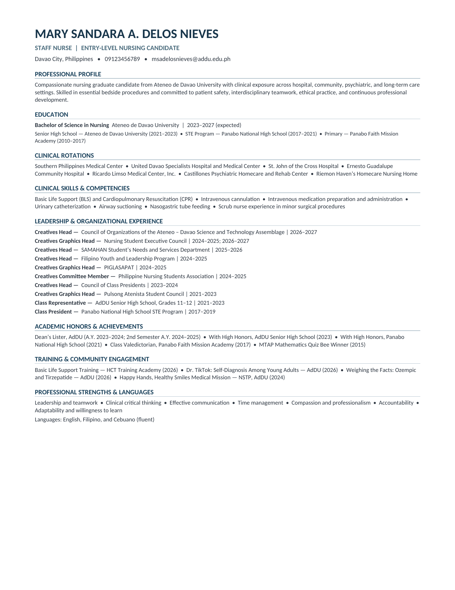

 

<b> ⟡⋆˙ ᴇxᴘʟᴏʀɪɴɢ ᴀɪ-ᴘᴏᴡᴇʀᴇᴅ ʀᴇꜱᴜᴍᴇ ᴄʀᴇᴀᴛɪᴏɴ ᴀɴᴅ ᴇᴠᴀʟᴜᴀᴛɪᴏɴ ⋆˙⟡ </b>

 

  
 

This activity explores the capabilities of <b>two Large Language Models (LLMs), Claude AI and ChatGPT,</b> in generating professional and visually appealing resumes. Using the same detailed prompt and personal information, both AI tools were instructed to create a one-page resume suitable for an entry-level Registered Nurse applying for a Staff Nurse position.

The activity aims to examine how different AI models interpret instructions, organize information, and present professional qualifications through document generation.

<table>
<tr>
<td width="14%" align="center">

<b> ʟʟᴍ 1 </b> 
  ᴄʟᴀᴜᴅᴇ ᴀɪ  

</td>

<td width="70%">

</td>
</tr>
</table>

<table>
<tr>
<td width="14%" align="center">

<b> ʟʟᴍ 2 </b> 
  ᴄʜᴀᴛɢᴘᴛ  

</td>

<td width="70%">

</td>
</tr>
</table>

 

<b>1. STRUCTURE</b>
 
 
<b>LLM 1</b> – Claude AI: Uses a two-column layout that organizes clinical skills, education, leadership experience, and achievements into separate sections.
 
<b>LLM 2</b> – ChatGPT: Uses a single-column layout with a logical sequence of sections, making the resume straightforward to navigate.

 

<b>2. CLARITY</b>
 
 
<b>LLM 1</b> – Claude AI: Provides detailed descriptions of qualifications and experiences, with bullet points and bold text for emphasis.
 
<b>LLM 2</b> – ChatGPT: Uses concise descriptions and simple wording, making essential information easier to scan.

 

<b>3. FORMATTING</b>
 
 
<b>LLM 1</b> – Claude AI: Features a blue-and-white color scheme, consistent typography, and clear section divisions. However, some areas appear crowded.
 
<b>LLM 2</b> – ChatGPT: Uses a minimalist design with blue headings and clean formatting, although the spacing and content distribution could be improved.

 

<b>4. OVERALL QUALITY</b>
 
 
<b>LLM 1</b> – Claude AI: Produces a comprehensive and visually balanced resume that effectively highlights the applicant's qualifications and experiences.
 
<b>LLM 2</b> – ChatGPT: Produces a clean and professional resume with straightforward organization but could benefit from better spacing and visual balance.

 

𝑷𝒓𝒆𝒇𝒆𝒓𝒓𝒆𝒅 𝑶𝒖𝒕𝒑𝒖𝒕

 

I prefer Claude AI's output because of its organized two-column layout, detailed presentation, and effective visual hierarchy. However, ChatGPT also offers a clean and minimalist approach. Both outputs demonstrate how AI tools can assist in creating professional resumes while highlighting the importance of proper content organization and design.

 
 

<i>

Through this activity, I learned how different Large Language Models can produce different results even when given exactly the same instructions. Comparing Claude AI and ChatGPT allowed me to recognize the importance of structure, clarity, formatting, and content organization when creating professional documents. I personally preferred Claude AI's output because of its balanced two-column layout, organized sections, and visually appealing presentation. However, I also appreciated ChatGPT's minimalist approach and concise descriptions.

</i>

<i>

This experience also taught me that AI-generated outputs should not be accepted without proper evaluation. Although AI can make document creation faster and more convenient, human judgment is still necessary to ensure accuracy, completeness, and professionalism. As a nursing student preparing for my future career, I realized how useful these tools can be in preparing professional documents such as resumes. Overall, this activity strengthened my understanding of AI-assisted content creation and the importance of choosing and refining outputs based on their intended purpose.

</i>

 

